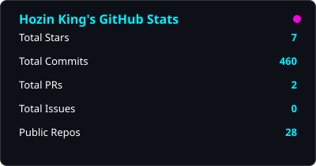
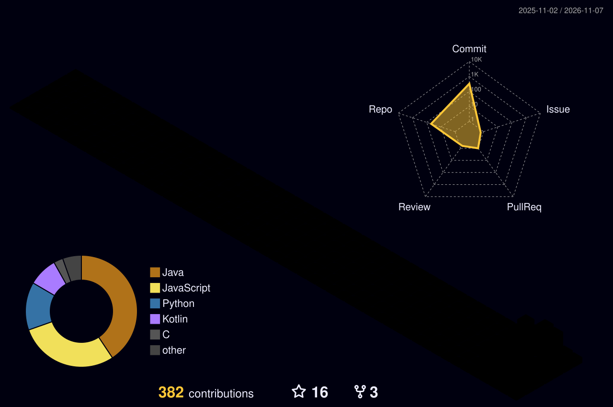

<p align="center">
  
</p>

<p align="center">
  
  
  
  
  
</p>

<p align="center">
  
  
  
  
</p>

---

### ⚡ About Me

```js
const hozin = {
    role: "Android Developer & Reverse Engineer",
    focus: ["Game Modding", "Root Injection", "ESP / Chams", "IL2CPP & UE Dumper"],
    stack: ["Java", "Kotlin", "C++", "NDK", "Python"],
    currently: "Building universal game injector with in-game ImGui menu",
    funFact: "Solo touring Bangko → Mukomuko on a Honda Beat 🏍️"
};
```

---

### 🎮 RGB Setup

<p align="center">
  
</p>

---

### 🛠️ Featured Projects

<!-- PROJECTS:START -->
| Project | Description | ⭐ |
|---|---|---|
| **[cerpen-hozin](https://github.com/hozin-king/cerpen-hozin)** | Aplikasi Cerpen Hozin — baca cerpen offline: 10+ cerpen original Bahasa Indonesia, sistem season & episode, lanjutkan membaca, berita teknologi offline. | ⭐ 0 |
| **[cctv-id-scraper](https://github.com/hozin-king/cctv-id-scraper)** | Scraper CCTV publik Indonesia -> cctv.json per wilayah (tiap 6 jam) | ⭐ 0 |
| **[hozin-ai-debate](https://github.com/hozin-king/hozin-ai-debate)** | Debat AI Bumi Bulat vs Bumi Datar — giliran ketat, history tersimpan, digerakkan GitHub Actions | ⭐ 0 |
| **[hozin-news-getter](https://github.com/hozin-king/hozin-news-getter)** | Auto-polling berita Indonesia (RSS) — 2 getter sekuensial tiap 10 menit | ⭐ 0 |
| **[hozin-cms](https://github.com/hozin-king/hozin-cms)** | CMS Hozin - web post + komentar + tema + plugin di Cloudflare Workers + D1 | ⭐ 0 |
| **[hozin-news-moderator](https://github.com/hozin-king/hozin-news-moderator)** | Moderator otomatis berita Hozin AI Studio (jalan tiap 15 menit) | ⭐ 1 |
| **[swarm-rebuild-bookmarklet](https://github.com/hozin-king/swarm-rebuild-bookmarklet)** | Bookmarklet Swarm Rebuild untuk Chrome Android — ubah halaman web jadi kanvas kosong lalu bangun kembali dengan kursor swarm. Versi bookmarklet dari ekstensi DhvanilPatel/swarm-cursors. | ⭐ 3 |
| **[touring-3d](https://github.com/hozin-king/touring-3d)** | Touring 3D — game touring motor keliling pulau Indonesia (libGDX, Android, full offline) | ⭐ 0 |
<!-- PROJECTS:END -->

---

### 📊 Stats

<p align="center">
  
  
</p>

<p align="center">
  
</p>

> Kartu statistik di-generate sendiri tiap hari oleh GitHub Actions (`stats.yml`) — tanpa layanan luar.

---

### 📋 Portofolio

<p align="center">
  
</p>

> Metrik oleh [lowlighter/metrics](https://github.com/lowlighter/metrics) — inspirasi desain: [Loukious](https://github.com/Loukious)

---

### 🐍 Contribution RGB

<p align="center">
  
</p>

> Ular RGB oleh [Platane/snk](https://github.com/Platane/snk) + pewarna pelangi (`scripts/rgb_snake.py`) — output `github-contribution-grid-snake-dark.svg`.

---

### 🧊 Contribution 3D

<p align="center">
  
</p>

---

### 🌐 Connect

<p align="center">
  <a href="https://www.tiktok.com/@hozin.king"></a>
  <a href="https://www.youtube.com/@LasWateAsli"></a>
</p>


