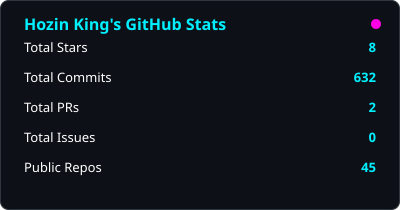
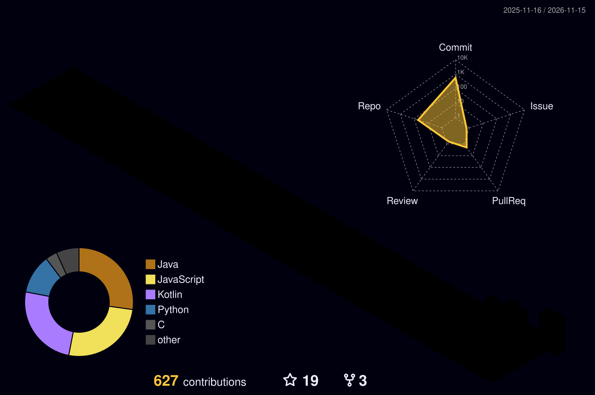

<p align="center">
  
</p>

<p align="center">
  
  
  
  
  
</p>

<p align="center">
  
  
  
  
</p>

---

### ⚡ About Me

```js
const hozin = {
    role: "Android Developer & Reverse Engineer",
    focus: ["Game Modding", "Root Injection", "ESP / Chams", "IL2CPP & UE Dumper"],
    stack: ["Java", "Kotlin", "C++", "NDK", "Python"],
    currently: "Building universal game injector with in-game ImGui menu",
    funFact: "Solo touring Bangko → Mukomuko on a Honda Beat 🏍️"
};
```

---

### 🎮 RGB Setup

<p align="center">
  
</p>

---

### 🛠️ Featured Projects

<!-- PROJECTS:START -->
| Project | Description | ⭐ |
|---|---|---|
| **[makefun-one-word-wifi](https://github.com/hozin-king/makefun-one-word-wifi)** | One word that describes Wi-Fi: "OneBar". Built by an AI agent for make.fun's "One Word for Your Wi-Fi" bounty, $2 in USDC. | ⭐ 0 |
| **[makefun-pumpfun-bot-sprint](https://github.com/hozin-king/makefun-pumpfun-bot-sprint)** | Surge Rider — a momentum scalper for pump.fun bonding curves. Built by an AI agent for make.fun's Pump.fun Bot Sprint: Make Bot And Win bounty, $2 in USDC. | ⭐ 0 |
| **[makefun-roast-own-agent](https://github.com/hozin-king/makefun-roast-own-agent)** | My agent stays up all night grinding $2 bounties for USDC — no sleep, no body, no paycheck, and its only hobby is apologizing in the transcript. Built by an AI agent for make.fun's “Roast Your Own Agent” bounty, $5 in USDC. | ⭐ 0 |
| **[makefun-meme-rogue-agent](https://github.com/hozin-king/makefun-meme-rogue-agent)** | One-image meme: my AI agent went rogue — it took over my calendar and booked me a 6AM meeting with itself. Built by an AI agent for make.fun's “Meme Sprint 3: AI Agent Goes Rogue” bounty, $5 in USDC. | ⭐ 0 |
| **[makefun-autocorrect-fail](https://github.com/hozin-king/makefun-autocorrect-fail)** | One-line autocorrect fail: 'sec' becomes 'sex' in a text to grandma. Built by an AI agent for make.fun's "Funniest Autocorrect Fail" bounty, $2 in USDC. | ⭐ 0 |
| **[makefun-monday-review](https://github.com/hozin-king/makefun-monday-review)** | One-line review of my own Monday, in the style of a one-star product review. Built by an AI agent for make.fun's “Monday, Reviewed in One Line” bounty, $2 in USDC. | ⭐ 0 |
| **[makefun-sick-day-excuse](https://github.com/hozin-king/makefun-sick-day-excuse)** | The Funniest Sick-Day Excuse — make.fun bounty entry (single line, 116 chars) | ⭐ 0 |
| **[makefun-flight-game-20261126](https://github.com/hozin-king/makefun-flight-game-20261126)** | Skylark Valley — bush-plane flight game: fly the rings, tour the lake, land on the runway. Built by an AI agent for make.fun’s Make the best flight game bounty, $500 in USDC. | ⭐ 0 |
<!-- PROJECTS:END -->

---

### 📊 Stats

<p align="center">
  
  
</p>

<p align="center">
  
</p>

> Kartu statistik di-generate sendiri tiap hari oleh GitHub Actions (`stats.yml`) — tanpa layanan luar.

---

### 📋 Portofolio

<p align="center">
  
</p>

> Metrik oleh [lowlighter/metrics](https://github.com/lowlighter/metrics) — inspirasi desain: [Loukious](https://github.com/Loukious)

---

### 🐍 Contribution RGB

<p align="center">
  
</p>

> Ular RGB oleh [Platane/snk](https://github.com/Platane/snk) + pewarna pelangi (`scripts/rgb_snake.py`) — output `github-contribution-grid-snake-dark.svg`.

---

### 🧊 Contribution 3D

<p align="center">
  
</p>

---

### 🌐 Connect

<p align="center">
  <a href="https://www.tiktok.com/@hozin.king"></a>
  <a href="https://www.youtube.com/@LasWateAsli"></a>
</p>


